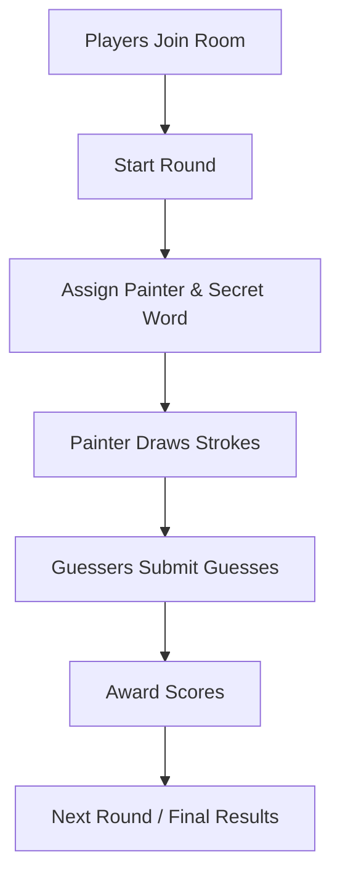
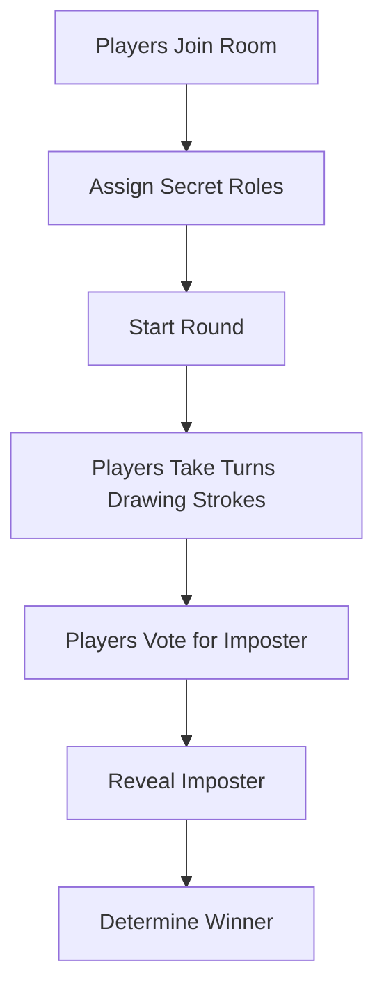

# Domain-Driven Design (DDD)

# 1. Business Domain: Multiplayer Drawing & Guessing Game

## Overview

A real-time multiplayer game where Players join Rooms, draw pictures, and interact with others through two game modes: **Classic Mode (MVP)** and **Imposter Mode (Future)**.

The game uses a Client–Server architecture, where the Server manages Rooms, Players, game rules, and synchronizes gameplay in real time.

# 2. Core Subdomains

## 2.1. Classic Mode (MVP)

A drawing-and-guessing game where a **Painter** draws a **Secret Word** while other Players act as **Guessers** and submit **Guesses** to earn **Scores**.

**Core Gameplay:**

## 2.2. Imposter Mode (Future)

A social deduction game where Players collaboratively draw a Secret Word, but one Player is secretly assigned as the **Imposter** and does not know the word.

**Core Gameplay:**

